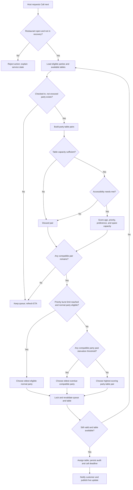
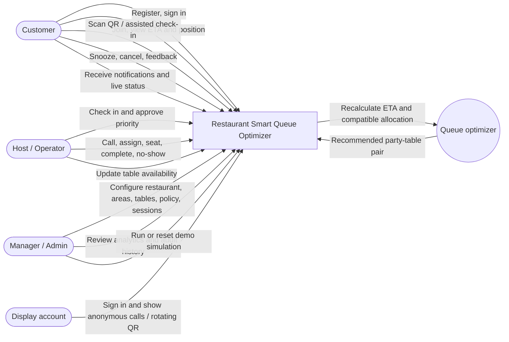
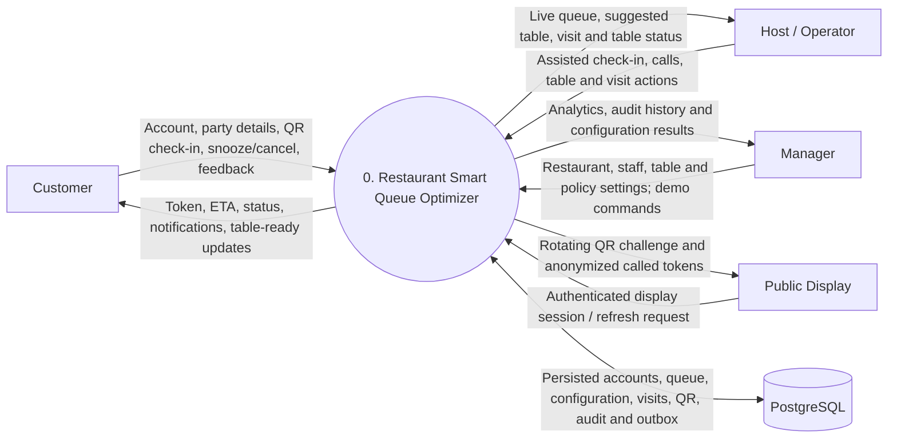
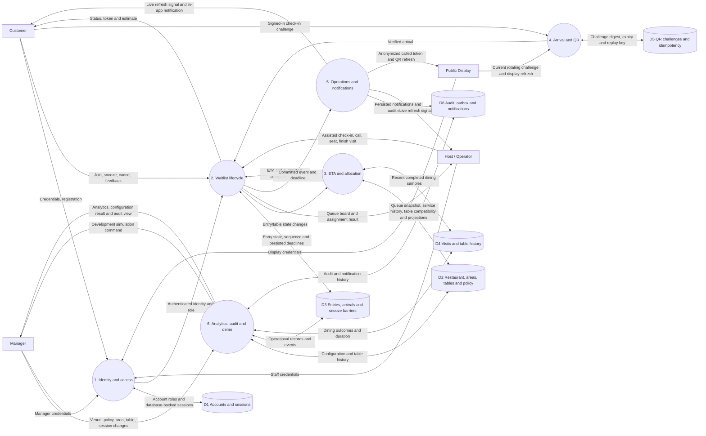

# Restaurant Smart Queue Optimizer — Diagrams

These diagrams describe the implemented single-restaurant workflow. Mermaid blocks render in GitHub and compatible Markdown viewers.

## 1. Call-next decision tree

## 2. Allocation decision table

Rules are evaluated after the restaurant/session lock and server-side state revalidation. A table is only considered when its state is `AVAILABLE` and it is enabled.

| Party checked in? | Table enabled and available? | Capacity fits? | Accessibility fits? | Priority burst / fairness | Outcome |
|---|---|---|---|---|---|
| No | Any | Any | Any | Any | Party is ineligible for dispatch |
| Yes | No | Any | Any | Any | Exclude table |
| Yes | Yes | No | Any | Any | Exclude party-table pair |
| Yes | Yes | Yes | No | Any | Exclude party-table pair |
| Yes | Yes | Yes | Yes | Normal party waiting and priority burst limit reached | Choose oldest eligible normal party |
| Yes | Yes | Yes | Yes | Compatible party has exceeded starvation threshold | Choose oldest overdue compatible party |
| Yes | Yes | Yes | Yes | Otherwise | Rank compatible pairs by fairness age, verified priority, preferred area, and capacity efficiency |
| Any | Conflicting concurrent update | Any | Any | Any | Revalidate under lock; reject stale request or recompute |

A party of two can use a 2-, 4-, 6- or 8-seat table; scoring favors the smaller suitable table. A party of six cannot use a 2- or 4-seat table. Accessibility is a hard constraint; dining-area preference is a soft preference. Hosts can make audited assignment changes while preserving these physical constraints.

## 3. Use case diagram

## 4. Data flow diagram — Level 0 (context)

## 5. Data flow diagram — Level 1

